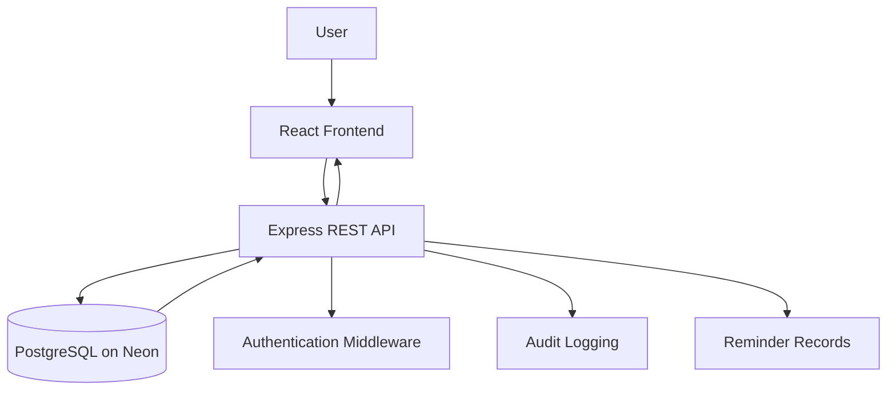

# ComplyTrack

### Contractor Compliance. Simplified.

**A modern contractor compliance management platform built for small organisations in South Africa.**

ComplyTrack aims to help organisations manage contractor information, organise compliance documentation, monitor expiry dates, and identify documents that require attention — all through one centralised platform.

<p align="center">

  

</p>

<p align="center">
  
  
  
  
  
</p>

---

## Table of Contents

- [Overview](#overview)
- [The Problem](#the-problem)
- [Our Solution](#our-solution)
- [Core Features](#core-features)
- [Technology Stack](#technology-stack)
- [System Architecture](#system-architecture)
- [Project Structure](#project-structure)
- [Getting Started](#getting-started)
- [Environment Configuration](#environment-configuration)
- [Database Setup](#database-setup)
- [Development Workflow](#development-workflow)
- [CI/CD and Code Quality](#cicd-and-code-quality)
- [Security Considerations](#security-considerations)
- [Team and Responsibilities](#team-and-responsibilities)
- [Roadmap](#roadmap)
- [Contributing](#contributing)
- [Project Status](#project-status)
- [License](#license)

---

## Overview

ComplyTrack is a web-based contractor compliance document tracking system designed with the needs of small organisations in South Africa in mind.

Managing contractor compliance can involve multiple documents, different expiry dates, repeated follow-ups, and scattered records. Without a centralised system, keeping track of these requirements can become time-consuming and difficult.

ComplyTrack is being developed to make this process more organised, accessible, and easier to monitor.

The project combines a React frontend, a Node.js and Express backend, and a PostgreSQL database hosted on Neon. The architecture is being developed with maintainability, security, testing, and future deployment in mind.

## The Problem

Organisations working with contractors may need to keep track of documents such as:

- Tax Compliance Status PINs
- COIDA Letters of Good Standing
- B-BBEE certificates or affidavits
- Public liability insurance documents
- Occupational Health and Safety documentation

When this information is managed manually, organisations can experience:

- Difficulty identifying expired or missing documents.
- Time-consuming searches for contractor records.
- Missed renewal dates and follow-up opportunities.
- Inconsistent record keeping.
- Limited visibility into overall contractor compliance.

## Our Solution

ComplyTrack aims to provide a centralised workspace where authorised users can manage contractor records, maintain document information, and identify compliance issues before they become bigger problems.

The long-term goal is to help organisations spend less time managing scattered records and more time making informed decisions about contractor compliance.

## Core Features

### Contractor Management

- Centralised contractor records.
- Contractor details and status management.
- Searchable contractor directory.
- Contractor-specific document visibility.

### Compliance Document Tracking

- Organised document records linked to contractors.
- Support for different compliance document categories.
- Document issue and expiry date tracking.
- Review states for pending, approved, and rejected documents.
- Identification of missing, expired, and soon-to-expire documentation.

### Dashboard and Reporting

- A dashboard for an overview of contractor compliance.
- Summary information about document status.
- Reporting endpoints for compliance information.
- A foundation for identifying records that require attention.

### Reminders and Auditability

- A database model for document-related reminders.
- Audit log records for important system activities.
- A foundation for future automated expiry notifications and compliance history.

> **Development note:** ComplyTrack is actively being developed. Some screens currently use demonstration data, and certain features are architectural foundations rather than completed production functionality.

---

## Technology Stack

| Layer | Technology | Purpose |
|---|---|---|
| Frontend | React + Vite | User interface and development server |
| Language | JavaScript / JSX | Frontend and backend application logic |
| Styling | CSS; Tailwind CSS planned for the frontend styling workflow | Responsive interface and reusable design patterns |
| Routing | React Router | Client-side navigation |
| Icons | Lucide React | Interface icons |
| HTTP client | Axios | Frontend-to-backend API requests |
| Backend | Node.js + Express | REST API and application logic |
| Database | PostgreSQL | Relational data storage |
| Database hosting | Neon | Hosted PostgreSQL environment |
| Authentication | JWT foundation | Authentication implementation |
| Testing and quality | ESLint, project tests, GitHub Actions | Code quality and automated validation |
| Security analysis | GitHub CodeQL | Static code security analysis |
| Version control | Git + GitHub | Collaboration and source control |
| Planned frontend hosting | Vercel | Frontend deployment |
| Planned backend hosting | Render or Railway | Backend deployment |

---

## System Architecture

ComplyTrack follows a frontend–backend–database architecture.



### How the system works

1. **Frontend:** Users interact with the React application to view contractor information, navigate pages, and manage compliance workflows.
2. **API:** The Express backend receives requests, applies business rules, validates input, and communicates with the database.
3. **Database:** PostgreSQL stores users, contractors, document types, documents, reminders, and audit logs.
4. **Authentication:** The authentication layer is intended to restrict access to authorised users as implementation progresses.
5. **Reporting:** Backend endpoints provide summary information for the dashboard and reporting interface.

The frontend and backend are separated to keep presentation, application logic, and data storage independently maintainable.

### Prerequisites

Make sure you have the following installed:

- [Node.js](https://nodejs.org/) and npm.
- [Git](https://git-scm.com/).
- A [Neon](https://neon.tech/) PostgreSQL database.
- A code editor such as Visual Studio Code.

### 1. Clone the repository

```bash
git clone https://github.com/Goon-Platoon4/ComplyTrack.git
cd ComplyTrack
```

### 2. Install dependencies

From the project root:

```bash
npm install
```

If your root package does not install all workspace dependencies, install them separately:

```bash
cd backend
npm install

cd ../frontend
npm install

cd ..
```

### 3. Configure the backend

```bash
cd backend
cp .env.example .env
```

Open `backend/.env` and configure your database connection and other required settings.

Example:

```env
PORT=5000
DATABASE_URL=your_neon_postgresql_connection_string
JWT_SECRET=replace_with_a_long_random_secret
FRONTEND_URL=http://localhost:5173
```

Never commit `.env` files or real credentials to GitHub.

### 4. Configure the frontend

Open another terminal:

```bash
cd frontend
cp .env.example .env
```

Configure the API URL:

```env
VITE_API_URL=http://localhost:5000/api
```

### 5. Set up the database

Open the SQL editor for your Neon PostgreSQL project and run the contents of:

```text
backend/schema.sql
```

Use the schema version approved by your team. If your database already contains tables, inspect the existing schema before running table-creation scripts again.

### 6. Start the backend

From the `backend` directory:

```bash
npm run dev
```

The backend is expected to run at:

```text
http://localhost:5000
```

### 7. Start the frontend

From the `frontend` directory in a second terminal:

```bash
npm run dev
```

Vite normally serves the application at:

```text
http://localhost:5173
```

Open the URL printed in the terminal if Vite selects a different port.

> **Note:** These commands assume the relevant `dev` scripts are configured in each package. The exact available scripts are defined by the project's `package.json` files.

---

## Environment Configuration

| Variable | Location | Purpose |
|---|---|---|
| `PORT` | Backend | Port used by the Express server |
| `DATABASE_URL` | Backend | PostgreSQL connection string |
| `JWT_SECRET` | Backend | Secret used for JWT signing and verification |
| `FRONTEND_URL` | Backend | Frontend origin used for CORS configuration |
| `VITE_API_URL` | Frontend | Base URL used by the frontend API client |

Environment variables help keep configuration separate from application source code.

**Important:** Frontend variables prefixed with `VITE_` are exposed to client-side code. Never put database passwords, JWT signing secrets, or other server-only credentials in frontend environment variables.

---

## Database Design

ComplyTrack uses a relational database to keep related information organised and maintain data integrity.

| Table | Responsibility |
|---|---|
| `users` | User accounts and roles |
| `contractors` | Contractor and business details |
| `document_types` | Categories of compliance documentation |
| `documents` | Document records, expiry dates, and review states |
| `reminders` | Scheduled or pending document reminders |
| `audit_logs` | Records of selected system activities |

### Key relationships

- One contractor can have multiple documents.
- One document type can be associated with multiple documents.
- One user can upload multiple documents.
- One document can have multiple reminder records.
- Users, contractors, and documents can be associated with audit records.

Primary keys identify records, while foreign keys enforce relationships between related tables.

---

## Development Workflow

ComplyTrack uses Git and GitHub to support collaborative development and controlled integration.

### Branch strategy

| Branch | Purpose |
|---|---|
| `main` | Production-ready code |
| `develop` | Shared integration branch |
| `feature/*` | New features and improvements |
| `fix/*` | Bug fixes |
| `docs/*` | Documentation changes |

### Standard contribution process

1. Start from the latest `develop` branch.
2. Create a dedicated branch for your assigned task.
3. Implement the change and test it locally.
4. Commit using a clear, descriptive commit message.
5. Push the branch to GitHub.
6. Open a pull request targeting `develop`.
7. Review the code and resolve any CI failures.
8. Merge after the required checks and reviews are complete.
9. Promote tested changes from `develop` to `main` when the team is ready for a release.

Example:

```bash
git switch develop
git pull origin develop
git switch -c feature/contractor-management

# Make and test your changes

git add .
git commit -m "feat(frontend): implement contractor management"
git push -u origin feature/contractor-management
```

For more details, see:

- [`docs/TEAM-GIT-GITHUB.md`](docs/TEAM-GIT-GITHUB.md)
- [`docs/COMPLYTRACK-WORKFLOW.md`](docs/COMPLYTRACK-WORKFLOW.md)
- [`docs/GITHUB-KANBAN-BACKLOG.md`](docs/GITHUB-KANBAN-BACKLOG.md)

---

## CI/CD and Code Quality

ComplyTrack includes GitHub Actions workflows to support automated checks.

### Continuous Integration

The CI workflow is designed to run checks on pushes and pull requests targeting the `develop` and `main` branches.

The pipeline contains the following jobs:

| Job | Purpose |
|---|---|
| Lint | Checks code against configured ESLint rules |
| Tests | Runs the project's automated tests |
| Dependency Security | Audits production dependencies for reported vulnerabilities |
| Build | Verifies that the application builds successfully after prerequisite checks pass |

### CodeQL

The CodeQL workflow performs static code security analysis on the configured JavaScript/TypeScript codebase.

### Why this matters

Automated checks help the team identify errors earlier, maintain consistent code quality, and reduce the risk of merging changes that break the application.

A successful CI run is an important quality gate, but it does not replace manual review, integration testing, or security testing.

---

## Security Considerations

Security is an important part of the ComplyTrack design.

The project is intended to follow these practices as implementation progresses:

- Keep credentials and connection strings in environment variables.
- Store password hashes rather than plain-text passwords.
- Validate and sanitise incoming API data.
- Restrict access to protected endpoints.
- Apply appropriate user roles and permissions.
- Validate uploaded files and restrict permitted file types.
- Store uploaded documents using an appropriate file-storage service.
- Record important operations in audit logs.
- Review dependencies and address relevant vulnerabilities.
- Use encrypted database connections and HTTPS in deployed environments.
- Establish backup and data-retention procedures.

These are implementation goals and security practices; their inclusion here should not be taken as confirmation that every control is already active.

---

## Team and Responsibilities

ComplyTrack is developed collaboratively, with each team member responsible for a primary area of the system.

| Team member | Area | Responsibilities |
|---|---|---|
| **Tyrique** | Frontend Development | React components, page layouts, navigation, responsive UI, API integration, and frontend usability. |
| **Kevin** | Backend Development | Express API routes, controllers, business logic, authentication middleware, validation, and backend integration. |
| **Themba** | Database Development | PostgreSQL schema, entity relationships, constraints, indexes, seed data, data integrity, and Neon database configuration. |
| **Zandre** | Testing and Quality Assurance | Test planning, functional testing, regression testing, defect reporting, verification of fixes, and testing evidence. |

Although each member has a primary responsibility, integration, code reviews, documentation, and release readiness remain shared team responsibilities.

---

## Roadmap

ComplyTrack is under active development. The following roadmap outlines the intended direction of the project.


*Roadmap items should be marked complete only when the relevant functionality has been implemented and verified.*

---

## Contributing

Contributions should follow the team's Git and GitHub workflow.

Before submitting a pull request:

1. Ensure your branch is based on the latest `develop`.
2. Follow the project's existing conventions.
3. Run the available lint, test, and build commands.
4. Update documentation where necessary.
5. Describe the changes and testing performed in your pull request.
6. Address review feedback before merging.

Use focused branches and commits so that changes are easier to review, test, and maintain.

## Project Status

**Current status: Active development**

ComplyTrack is being developed as a capstone project. Its architecture and workflows are being established incrementally, with functionality being implemented and tested as the project progresses.

Features described as planned or in development should not be assumed to be production-ready.

## License

No open-source license has been specified yet. Unless a license is added to the repository, reuse and redistribution are subject to the applicable copyright rules.

---

<p align="center">
  <strong>ComplyTrack</strong><br />
  Making contractor compliance easier to manage.
</p>